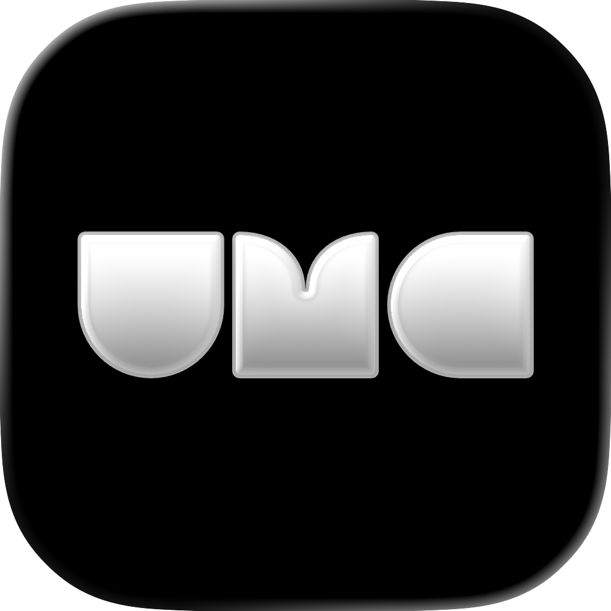
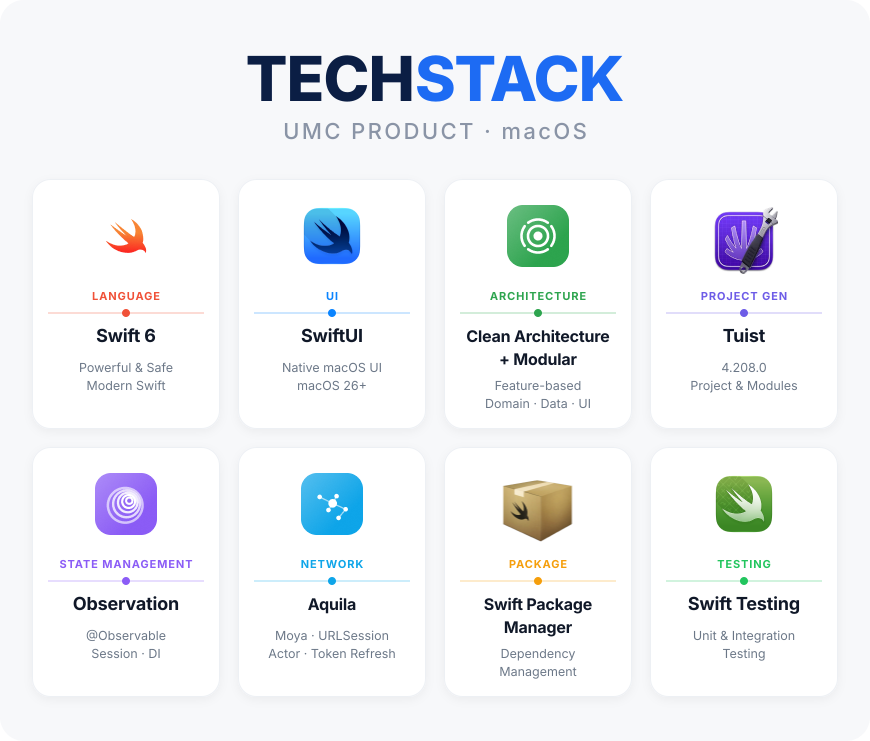

<div align="center">



# UMC Desk

**공지와 대화, 프로젝트 작업을 Mac에서 이어가는 UMC 워크스페이스**

[프로젝트 위키](https://github.com/UMC-PRODUCT/umc-product-macOS/wiki) · [개발 시작](https://github.com/UMC-PRODUCT/umc-product-macOS/wiki/Development) · [모듈 구조](https://github.com/UMC-PRODUCT/umc-product-macOS/wiki/Module-Structure)

</div>

## 프로젝트

UMC Desk는 UMC 구성원이 공지와 대화를 확인하고 프로젝트 자료와 결정사항을 연결해 작업을 이어갈 수 있도록 만드는 macOS 앱입니다.

2026-10-13 기준 앱 진입점은 `AuthView`입니다. 로그인·회원가입·비밀번호 재설정·챌린저 인증과 오류·점검·업데이트 상태 UI, Light·Dark 디자인 토큰, 공통 체크박스를 구현했습니다. Debug와 프리배포 빌드에서는 화면·흐름·타이포그래피 미리보기를 사용할 수 있습니다.

인증 화면은 로컬 상태로 동작하며 실제 로그인·메일 인증·회원가입·업데이트 API는 연결되지 않았습니다. Auth를 포함한 7개 Feature에 Domain·Data·Presentation 모듈을 두었고, 나머지 6개 Feature의 서비스 화면과 도메인 구현은 준비 단계입니다. 네트워크·Keychain 토큰 저장·세션 초기화·의존성 주입 기반은 앱에 등록되어 있습니다.

## 기술 스택



[Figma 디자인](https://www.figma.com/design/kM8a1siXgusAVRRgyUZ15U/UMC-Mac-OS) · [빌드·테스트 상태](https://github.com/UMC-PRODUCT/umc-product-macOS/actions/workflows/tuist-ci.yml)

## 문서

소스와 함께 관리하는 [문서 인덱스](docs/README.md)와 [개발 명령 안내](UMCDesk/MAKEFILE_GUIDE.md)에서 시작할 수 있습니다. 위키는 같은 자료를 주제별로 안내합니다.

| 안내 | 저장소 문서·위키 |
|:---|:---|
| 개발 환경과 첫 실행 | [Makefile 안내](UMCDesk/MAKEFILE_GUIDE.md) · [개발 시작](https://github.com/UMC-PRODUCT/umc-product-macOS/wiki/Development) |
| Feature·Core 구성과 네트워크·토큰 처리 | [아키텍처](docs/Codex/architecture.md) · [모듈 구조](https://github.com/UMC-PRODUCT/umc-product-macOS/wiki/Module-Structure) |
| 디자인 시스템과 구현 규약 | [디자인 시스템](docs/Codex/design-system.md) · [개발 가이드](https://github.com/UMC-PRODUCT/umc-product-macOS/wiki/Development-Guide) |
| 프리배포·DMG 자동화 | [Cloud 배포 안내](tools/xcode-cloud/README.md) · [배포 설계](docs/specs/배포_Xcode%20Cloud와%20공증%20DMG%20및%20설치%20사이트_설계.md) |
| PRD·앱 설계·구현 계획 | [기획·설계](https://github.com/UMC-PRODUCT/umc-product-macOS/wiki/Product-Docs) |
| 서버 명세·연동 확인 | [서버 조회 가이드](docs/Codex/server-repo.md) · [서버 문서](https://github.com/UMC-PRODUCT/umc-product-macOS/wiki/Server-Docs) |
| Apple 프레임워크·스킬팩 | [Apple 레퍼런스](docs/Codex/apple-frameworks/INDEX.md) |

## 개발 시작

macOS 26 이상, macOS 26 SDK를 포함한 Xcode, Swift 6, mise가 필요합니다. Tuist는 `4.208.0`으로 고정되어 있으며 아래 명령은 저장소 루트에서 실행할 수 있습니다.

```sh
make bootstrap
make install
make generate
make open
```

기본 API 주소는 `.invalid` 임시값입니다. 서버에 연결할 때는 [환경 설정 안내](UMCDesk/Secrets/README.md)를 따릅니다. 빌드·테스트와 DMG 생성 명령은 [Makefile 안내](UMCDesk/MAKEFILE_GUIDE.md)에 정리되어 있습니다.

프리배포는 승인·병합된 `develop`의 커밋에서 `prerelease/<앱버전>/<빌드번호>` 브랜치를 푸시하는 흐름입니다. 저장소에는 Xcode Cloud 준비 스크립트와 DMG 게시용 Actions가 있습니다. Actions는 공증 산출물을 받아 GitHub Pre-release에 DMG를 게시합니다. Cloud 워크플로·서명·비밀값 설정과 실제 배포 성공 여부는 별도로 확인해야 합니다.

---

<div align="center">

[UMC PRODUCT](https://github.com/UMC-PRODUCT)

</div>
