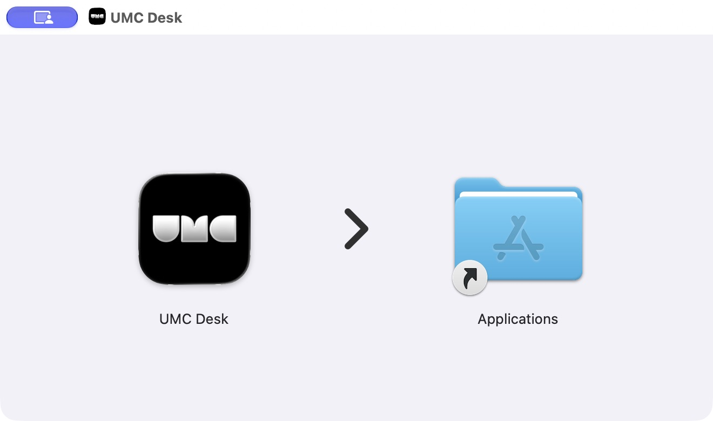

# UMCDesk development

Verified against the repository on 2026-10-13.

Requirements: macOS 26 or later, Xcode with the macOS 26 SDK, Swift 6, and mise.
Tuist is pinned to `4.208.0` in [mise.toml](mise.toml). DMG packaging needs Python;
use Python 3.11 or later for the complete Cloud packaging toolchain.

Commands work from the repository root or from `UMCDesk/`. The root Makefile
delegates to `UMCDesk/Makefile` and preserves variable overrides.

## First setup

Install mise if needed, then run:

```sh
make bootstrap
make install
make generate
make open
```

`bootstrap` checks for mise, trusts `mise.toml`, and installs the pinned tools. It
does not install mise itself. `open` generates the workspace only if it is absent;
use `generate` after changing a manifest or a Tuist environment variable.

Copy `Secrets/Secrets.xcconfig.template` to the ignored `Secrets/Secrets.xcconfig`
before connecting to a real API. The committed `.invalid` URL supports generation
and startup without secrets, but is not a live server. See the
[configuration guide](Secrets/README.md).

## Current implementation

The app hosts `AuthView` with the shared `UMCCheckboxStyle`. Authentication,
registration, password reset, challenger verification, account confirmation,
error, maintenance and update screens use local state. Auth Domain and Data are
scaffolds; these screens do not perform authentication or update network calls.
The other six Feature projects are also scaffolds.

All seven Feature projects contain Domain, Data and Presentation static
frameworks. Each of the seven Core projects contains one static framework.
`AppDependencies` registers networking, Keychain token storage, the user session
and session cleanup. `CoreDesignSystem` provides Light/Dark colors, typography,
spacing and radii; `CoreUIComponents` provides the checkbox style.

[Aquila](https://github.com/JEONG-J/Aquila) supplies HTTP transport, shared token
refresh, Moya mapping and logging. The revision is pinned in `Tuist/Package.swift`.
CoreNetwork retains UMC response decoding, localized errors and macOS session
wiring. There is no repository-local network package under `Packages/`.

## Development commands

```sh
make help
make doctor
make build
make pick
make test
make test-pick
make test SCHEME=AuthPresentation
make test SCHEME=CoreDI
make test-network
make build CONFIGURATION=Release CODE_SIGNING_ALLOWED=NO
make graph
make edit
make edit-project
make generate-open
make cache-warm
```

`make edit` opens the Tuist manifest editor for the app, seven Core projects,
seven Feature projects and ProjectDescriptionHelpers. Remote dependencies live
in `Tuist/Package.swift`, which is also included in the generated workspace.
`edit-project` creates a permanent edit project. Change manifests rather than
generated Xcode project files.

`pick` and `test-pick` use fzf when installed and numbered input otherwise. Select
a scheme with a test target for `test-pick`. `graph` writes `graph.png` and needs
Graphviz (`brew install graphviz`).

The default `UMCDesk` test scheme covers app, CoreDI, CoreDesignSystem and
CoreNetwork tests. Run `make test SCHEME=AuthPresentation` separately for Auth form
and appearance tests. `test-network` selects CoreNetwork against the pinned
Aquila dependency. `CODE_SIGNING_ALLOWED=NO` supports unsigned local build/test
checks; DMG commands intentionally sign the packaged app.

| Override | Default |
| --- | --- |
| `SCHEME` | `UMCDesk` |
| `DESTINATION` | `platform=macOS` |
| `CONFIGURATION` | `Debug` |
| `CODE_SIGNING_ALLOWED` | `YES` |
| `DERIVED_DATA` | `.local-derived-data` |
| `TUIST_BUILD_NUMBER` | Branch-derived value, otherwise manifest default `1` |
| `TUIST_PRERELEASE` | `1` for a valid prerelease branch, otherwise `0` |

## Debug, Release and prerelease controls

Debug includes Auth screen/flow, Light/Dark and typography preview controls.
An ordinary Release excludes those controls and the simulated delayed flow.
`TUIST_PRERELEASE=1` adds `UMC_PRERELEASE` at project generation, allowing the same
controls in a prerelease Release build. This flag is separate from the Xcode
configuration; changing it requires generation:

```sh
make generate TUIST_PRERELEASE=0
make build CONFIGURATION=Release CODE_SIGNING_ALLOWED=NO
make generate TUIST_PRERELEASE=1
make build CONFIGURATION=Release CODE_SIGNING_ALLOWED=NO
```

The preview email code is `123456`. Preview success screens are UI simulation,
not evidence of a server request or an installed update. The preview toolbar also
supports choosing error scenarios and individual Figma screens.

## Version and Xcode Cloud preparation

The current marketing version is `0.0.1`. Use a new positive integer build number
for each distribution and check existing tags before choosing one. Examples below
illustrate syntax and do not reserve or identify the latest published build.

Local Makefile generation reads the trailing build number from branches such as
`prerelease/0.0.1/12`, `release/12`, and `testFlight/12`. `CI_BRANCH` supplies the
branch in CI; an explicit `TUIST_BUILD_NUMBER` overrides local parsing. The
Makefile rejects a nonempty build number below `1`.

Xcode Cloud runs [ci_post_clone.sh](ci_scripts/ci_post_clone.sh) to install mise
when missing, install Tuist/dependencies and generate the workspace. A
`prerelease/<version>/<build>` branch must match `MARKETING_VERSION`; its trailing
number becomes `CFBundleVersion` and enables prerelease controls. Other Cloud
branches use `CI_BUILD_NUMBER` and disable prerelease controls. The Cloud run
counter and the app build number can therefore differ.

## Internal test DMG

```sh
make dmg-test TUIST_BUILD_NUMBER=12
make test-dmg
```

`dmg-test` generates the workspace and builds an ad-hoc signed universal Debug
app for Apple Silicon and Intel. Pinned packaging dependencies are installed
into `.local-dmg-tools/` on first use, which needs network access. The Finder
layout uses the app, an arrow and an Applications shortcut; dmgbuild writes the
window metadata without Finder automation.



The example produces `UMCDesk/dist/UMC-Desk-0.0.1-build12-test.dmg` and
`설치 안내.txt`. Recipients need macOS 26 or later. They drag UMC Desk onto
Applications and quit any older copy before replacing it. They do not need the
developer toolchain.

Test packages are not notarized. Gatekeeper may require System Settings → Privacy
& Security → Open Anyway for the first launch. Ad-hoc signing does not identify
the developer. This command creates local files; it does not publish a release.

## Local notarized DMG

Prepare a valid Developer ID Application identity and a notarytool Keychain
profile, then run:

```sh
make dmg-release TUIST_BUILD_NUMBER=12 NOTARY_PROFILE=UMCDeskNotary
```

The command generates a workspace, builds a universal Release app with Hardened
Runtime and a timestamp, notarizes/staples the app, then signs, notarizes/staples
and assesses the DMG. The output is `UMCDesk/dist/UMC-Desk-0.0.1-build12.dmg` plus
the installation guide. It refuses to replace an existing release DMG with the
same filename. Submission IDs and results remain in `dist/.notarization/` for
recovery with `xcrun notarytool info`.

Defaults are `SIGNING_IDENTITY=Developer ID Application`,
`DEVELOPMENT_TEAM=8B8B4462NV` and `NOTARY_PROFILE=UMCDeskNotary`. Override them for
your prepared signing environment. The command does not create a tag or GitHub
Release. A prerelease branch enables preview controls during generation; use an
explicit `TUIST_PRERELEASE` when preparing a different local distribution.

## Automated Cloud prerelease

Push `prerelease/<version>/<build>` from an approved commit already merged into
`origin/develop`. The configured Xcode Cloud Pre-release workflow builds and
notarizes the app. The GitHub Actions publication workflow waits for the matching
branch, source commit and Cloud workflow, then packages the notarized app into a
signed and notarized DMG. It uploads a draft with the DMG, `release.json` and
installation guide, then publishes a GitHub Pre-release.

The workflow requires external Cloud configuration and repository secrets; their
presence and deployment success cannot be established from the source files.
See [Cloud publication operations](../tools/xcode-cloud/README.md) for setup and
recovery. This path has no separate prerelease PR or webhook receiver in this
repository. Check API configuration separately before any server-connected
distribution; notarization does not validate app functionality.

## Cleanup

```sh
make clean
make clean-dd
make reset
make install
make generate
```

`clean` removes generated projects and resolved Tuist build data. `clean-dd`
removes local DerivedData and `Build/`; `reset` runs both. Cleanup stays inside
`UMCDesk/` and preserves module sources and secret configuration. Generated
projects, packaging tools, DMGs and notarization records stay out of Git.
