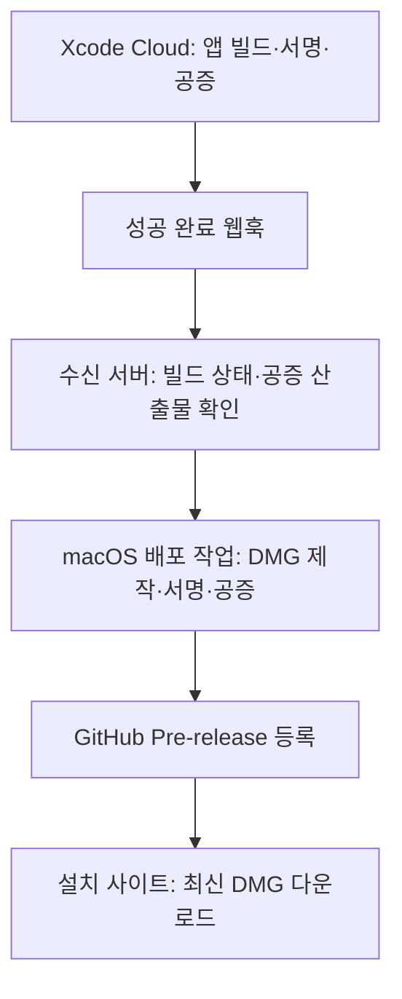

# UMC Desk 공증 DMG와 설치 사이트 배포 설계

작성일: 2026-10-11
작성자: 제옹(euijjang97)
상태: 배포 흐름 확정, Cloud 자동화와 설치 사이트 연결은 구현 전

UMC Desk 테스트 버전은 Xcode Cloud에서 앱을 빌드·서명·공증하고 별도의 macOS 배포 작업에서 DMG를 만들어 GitHub Pre-release에 게시한다. 설치 사이트는 GitHub에 게시된 최신 테스트 빌드의 DMG를 연결한다. 앱 버전은 `0.0.1`로 유지하고 배포할 때마다 빌드 번호를 올린다.

팀원은 설치 사이트에서 새 DMG를 받아 Applications의 기존 앱을 교체한다. 앱 내부의 새 버전 알림과 자동 업데이트는 이번 범위에 포함하지 않는다.

## 1. 현재 상태와 목표

| 항목 | 2026-10-11 기준 상태 |
| --- | --- |
| 앱 이름·아이콘·설치 화면 | UMC Desk와 제공 로고 적용. 앱을 Applications로 드래그하는 DMG 구성 완료 |
| 공증 배포 | 로컬에서 Developer ID 서명, 앱·DMG 공증과 티켓 첨부, Gatekeeper 검증 완료 |
| GitHub 배포 | `0.0.1 (2)`를 `v0.0.1-build.2` Pre-release로 게시 완료 |
| Xcode Cloud | 프로젝트 생성·앱 공증·산출물 전달을 연결해야 함 |
| GitHub 배포 자동화 | Cloud 산출물을 받아 DMG를 게시하는 작업을 추가해야 함 |
| 설치 사이트 | 웹훅 수신과 최신 DMG 다운로드 연결을 구현해야 함 |
| 서버 연동 테스트 | 현재 배포의 `BASE_URL`은 `.invalid` 임시값. UI·디자인 확인용 |

현재 배포는 [0.0.1 빌드 2 Pre-release](https://github.com/UMC-PRODUCT/umc-product-macOS/releases/tag/v0.0.1-build.2)에서 받을 수 있다. 구현 근거는 [PR #62](https://github.com/UMC-PRODUCT/umc-product-macOS/pull/62), [Makefile](https://github.com/UMC-PRODUCT/umc-product-macOS/blob/develop/UMCDesk/Makefile), [공증 스크립트](https://github.com/UMC-PRODUCT/umc-product-macOS/blob/develop/tools/dmg/build_release_dmg.py)다. 공증 성공은 API 설정이나 앱 기능의 정상 동작을 보장하지 않는다.

## 2. 확정한 배포 흐름



Xcode Cloud는 Developer ID 배포와 앱 공증을 지원한다. 이 프로젝트에서 사용하는 DMG 설치 화면과 GitHub 게시까지 연결하려면 별도의 macOS 배포 작업이 필요하다. [Apple 배포 워크플로 문서](https://developer.apple.com/documentation/xcode/creating-a-workflow-that-builds-your-app-for-distribution)

## 3. 버전과 배포 파일 규칙

| 항목 | 현재 배포 | 다음 배포 예시 |
| --- | --- | --- |
| `CFBundleShortVersionString` | `0.0.1` | `0.0.1` |
| `CFBundleVersion` | `2` | `3` |
| Git 태그 | `v0.0.1-build.2` | `v0.0.1-build.3` |
| DMG 파일 | `UMC-Desk-0.0.1-build2.dmg` | `UMC-Desk-0.0.1-build3.dmg` |
| GitHub 분류 | Pre-release | Pre-release |

빌드 번호는 양의 정수로 관리하고 이미 게시한 번호를 재사용하지 않는다. 이전 태그와 DMG를 보존하며 같은 태그의 파일을 다른 바이너리로 교체하지 않는다. 테스트 실패로 번호에 공백이 생겨도 다음 번호로 진행한다. 태그가 가리키는 커밋은 해당 앱을 실제로 빌드한 소스 SHA와 같아야 한다.

Cloud 전환 시 다음 빌드 번호를 `3` 이상이면서 이미 사용한 번호보다 크게 설정한다. Tuist 프로젝트를 생성하기 전에 `CI_BUILD_NUMBER`를 `TUIST_BUILD_NUMBER`로 전달하고 완성된 앱의 `CFBundleVersion`이 같은 값인지 다시 검사한다. Cloud와 로컬에서 번호를 따로 발급하지 않도록 배포 번호의 관리 지점을 하나로 정한다. [Cloud 환경 변수](https://developer.apple.com/documentation/xcode/environment-variable-reference), [다음 빌드 번호 설정](https://developer.apple.com/documentation/xcode/setting-the-next-build-number-for-xcode-cloud-builds/)

## 4. Xcode Cloud 구성

1. App Store Connect에서 UMC Desk와 저장소를 연결하고 macOS 배포용 워크플로를 만든다.
2. `ci_post_clone.sh`에서 프로젝트가 고정한 Tuist 버전과 의존성을 설치하고 워크스페이스를 생성한다. 현재 Tuist 버전은 `UMCDesk/mise.toml`의 `4.208.0`이다. 비공개 패키지가 있으면 Cloud의 읽기 권한도 연결한다.
3. Release Archive를 구성하고 Developer ID 배포와 앱 공증 후속 작업을 설정한다. 개발용 서명이나 ad-hoc 서명 앱은 게시하지 않는다.
4. 앱 버전 `0.0.1`, 배포 빌드 번호, `arm64`·`x86_64` 대상, 최소 macOS 26, 배포용 API 환경을 확인한다.
5. 초기에는 수동으로 배포를 시작하고 이후 팀이 정한 배포 브랜치만 자동 게시 대상으로 허용한다. 일반 PR 빌드는 배포 대상에서 제외한다.
6. 워크플로의 앱·워크플로 ID와 허용 소스 범위를 웹훅 수신 서버에 등록한다.

`ci_post_xcodebuild.sh` 실행을 Cloud 공증 완료 신호로 사용하지 않는다. 앱 공증 후속 작업까지 끝난 산출물을 다음 단계로 넘겨야 한다. Cloud 환경에서 필요한 설정은 현재 로컬 Makefile 실행과 별도로 구현한다. [Apple 커스텀 빌드 스크립트](https://developer.apple.com/documentation/xcode/writing-custom-build-scripts)

## 5. 완료 웹훅과 산출물 전달

웹훅 수신 서버는 설치 사이트의 서버 기능이나 별도 배포 서비스로 둔다. 아래 경로는 새로 구현할 제안이며 기존 제품 서버 API를 뜻하지 않는다.

```text
POST /api/webhooks/xcode-cloud
```

Xcode Cloud는 빌드 생성·시작·완료 때 웹훅을 보내며 실패한 전달을 재시도할 수 있다. 완료 이벤트라는 이유만으로 앱을 배포하지 않고 다음 순서로 확인한다. [Apple 웹훅 문서](https://developer.apple.com/documentation/xcode/configuring-webhooks-in-xcode-cloud)

1. `BUILD_COMPLETED` 이벤트와 허용된 앱·워크플로인지 검사한다. PR 빌드, 실패·취소된 빌드, 허용하지 않은 소스는 제외한다.
2. 전달된 빌드 ID로 App Store Connect API를 조회해 실제 성공 상태, 소스 SHA, 빌드 번호를 확인한다. 외부 요청 본문만 신뢰해 배포를 시작하지 않는다.
3. 앱 공증이 끝난 산출물인 `STAPLED_NOTARIZED_ARCHIVE`를 확인한다. 아직 준비되지 않았으면 조회를 재시도하고 정해진 대기 시간을 넘기면 배포를 중단한다.
4. `빌드 ID + 배포 채널`로 중복 처리를 막는다. 웹훅 재전달이 같은 Pre-release를 다시 만들면 안 된다.
5. 검증된 빌드 ID·소스 SHA·빌드 번호를 GitHub의 `repository_dispatch`로 전달한다. 다운로드 주소는 배포 작업이 App Store Connect API에서 새로 조회한다.
6. 수신 처리는 빠르게 응답하고 DMG 제작·공증은 비동기 작업으로 실행한다.

Cloud 산출물 API는 파일 종류와 다운로드 URL을 제공하며 URL에는 유효 시간이 있다. 장기 보관용 링크나 공개 다운로드 주소로 사용하지 않는다. 다운로드한 앱은 서명·공증 티켓과 버전을 다시 검사한다. [산출물 속성](https://developer.apple.com/documentation/appstoreconnectapi/ciartifact/attributes-data.dictionary), [산출물 조회 API](https://developer.apple.com/documentation/appstoreconnectapi/get-v1-ciartifacts-_id_)

`repository_dispatch`를 받을 워크플로 파일은 저장소의 기본 브랜치에 있어야 한다. 현재 기본 브랜치는 `develop`이다. 실행 코드가 빌드 소스의 커밋을 필요로 하면 전달받아 검증한 SHA를 명시적으로 체크아웃한다. 기본 브랜치의 최신 SHA를 앱의 소스 SHA로 대신 기록하지 않는다. [GitHub 이벤트 문서](https://docs.github.com/en/actions/reference/workflows-and-actions/events-that-trigger-workflows#repository_dispatch)

## 6. macOS에서 DMG 제작과 공증

배포 작업은 공증된 Cloud 앱을 받아 기존 앱·화살표·Applications 바로가기 레이아웃으로 DMG를 만든다. 앱을 다시 빌드하지 않고 전달받은 바이너리를 포장한다.

현재 [공통 패키징 코드](https://github.com/UMC-PRODUCT/umc-product-macOS/blob/develop/tools/dmg/build_dmg.py)의 `build(..., release=True)`와 배경·아이콘·설치 안내를 재사용할 수 있다. 이 함수만으로는 DMG 서명과 공증이 완료되지 않는다.

현재 `make dmg-release`는 로컬 빌드부터 시작하며 `build_release_dmg.py`는 앱 ZIP 공증도 수행한다. Cloud 앱을 그대로 받는 자동화에는 별도 진입점이 필요하다. 이미 공증된 앱의 티켓을 검증한 뒤 DMG 제작·서명·공증 단계로 연결하고 불필요한 앱 재공증을 반복하지 않는다.

| 작업 환경에 필요한 항목 | 용도 |
| --- | --- |
| App Store Connect API 인증 | Cloud 빌드 상태와 산출물 조회 |
| Developer ID Application 인증서와 개인 키 | DMG 서명 |
| 공증 인증과 Keychain 프로필 | DMG를 Apple 공증 서비스에 제출 |
| GitHub 게시 권한 | 태그·릴리스 생성과 파일 업로드 |

Cloud가 관리하는 앱 서명 환경과 macOS 배포 작업의 DMG 서명 환경은 별도로 준비한다. 로컬 Keychain 프로필이 Cloud나 GitHub Actions에 자동으로 복사되지는 않는다. 인증서·개인 키·API 키·비밀번호는 CI 비밀값으로 관리하고 저장소·위키·프런트엔드·공개 로그에 넣지 않는다. 임시 Keychain과 임시 파일은 작업이 끝나면 정리한다.

게시 전에는 다음 검증을 모두 통과해야 한다.

- 앱 이름, 버전 `0.0.1`, 예상 빌드 번호, CPU 아키텍처와 API 환경 검사
- 앱의 Developer ID 서명, Hardened Runtime, 공증 티켓과 Gatekeeper 검사
- DMG 제작 후 Developer ID 서명, 공증 `Accepted` 판정, 티켓 첨부와 검증
- DMG 마운트 후 복사한 앱의 서명·티켓·Gatekeeper 검사
- 최종 DMG의 무결성, 파일 크기와 SHA-256 기록

Apple은 직접 배포할 최종 컨테이너를 공증하도록 안내한다. 이 설계에서는 Cloud 앱 공증에 이어 최종 DMG를 공증한다. [Apple 패키징 문서](https://developer.apple.com/documentation/xcode/packaging-mac-software-for-distribution)

## 7. GitHub Pre-release 게시

1. 같은 빌드의 게시 여부와 기존 태그의 소스 SHA를 확인한다. 충돌이 있으면 덮어쓰지 않고 중단한다.
2. 실제 Cloud 소스 SHA를 가리키는 태그와 Draft 릴리스를 준비한다.
3. 검증한 DMG와 터미널 사용이 필요 없는 설치 안내를 업로드한다.
4. 업로드된 파일 크기와 SHA-256을 원본과 대조한다.
5. 앱 버전·빌드 번호, 지원 macOS·CPU, 변경점과 알려진 제약을 릴리스 본문에 기록한다.
6. 검증이 끝나면 `prerelease=true`, `draft=false`로 게시한다.

부분 업로드나 공증 실패 상태는 사이트에 노출하지 않는다. 게시가 끝난 기존 DMG와 태그를 다시 쓰지 않는다. 서명·공증·게시 실패 시 직전 정상 배포를 유지한다.

## 8. 설치 사이트에서 최신 DMG 연결

사이트의 다운로드 버튼은 매번 바뀌는 GitHub 파일 URL 대신 사이트의 고정 주소를 사용한다.

```text
GET /api/downloads/macos?channel=beta
```

이 경로는 설치 사이트에 구현할 제안이다. 서버가 GitHub 릴리스 목록을 조회해 선택한 DMG의 `browser_download_url`로 리다이렉트한다.

```text
GET https://api.github.com/repos/UMC-PRODUCT/umc-product-macOS/releases
```

현재 테스트 채널의 선택 조건은 다음과 같다.

- `draft=false`이고 `prerelease=true`인 릴리스
- 태그가 `v0.0.1-build.N` 형식이며 `N`이 양의 정수인 릴리스
- 태그와 일치하는 `UMC-Desk-0.0.1-buildN.dmg`가 업로드 완료된 릴리스
- 위 조건을 통과한 후보 중 `N`을 정수로 비교해 가장 큰 빌드

문자열 정렬로 빌드 10을 빌드 9보다 오래된 것으로 처리하지 않는다. 목록은 페이지네이션을 처리하고 Draft나 미완료 업로드를 최신 배포로 선택하지 않는다. `/releases/latest`는 Pre-release를 제외하므로 테스트 채널에는 사용하지 않는다. [GitHub 릴리스 API](https://docs.github.com/en/rest/releases/releases)

릴리스 조회는 서버에서 짧게 캐시한다. 초기 캐시 주기는 5분을 제안하며 사이트 운영 환경에서 확정한다. GitHub 조회 실패 시 마지막으로 검증한 정상 다운로드 정보를 유지하고 유효한 정보가 전혀 없으면 다운로드 준비 중 상태를 보여준다. 인증 토큰을 브라우저에 전달하지 않는다.

파일은 GitHub가 제공하고 사이트는 버전·빌드 번호·변경점·다운로드 버튼을 제공한다. 빌드 3을 게시하면 캐시 갱신 후 버튼이 빌드 3을 연결하므로 사이트 소스의 다운로드 URL을 매번 수정할 필요가 없다.

## 9. 운영과 실패 복구

| 상황 | 처리 |
| --- | --- |
| 빌드 또는 앱 공증 실패 | DMG 작업과 GitHub 게시를 시작하지 않는다. 직전 정상 배포 유지 |
| 공증 산출물 준비 지연 | 상태를 재조회한다. 대기 한도를 넘기면 중단하며 서명만 된 앱으로 대체하지 않는다 |
| DMG 공증 거절 | 제출 UUID로 로그를 확인한다. 거절된 파일은 게시하지 않는다 |
| 공증 대기 중 작업 중단 | 저장된 UUID의 상태부터 확인한다. 같은 파일을 무조건 다시 제출하지 않는다 |
| 웹훅 중복·작업 재실행 | 기존 빌드 ID와 태그를 조회한다. 이미 게시된 동일 빌드는 그대로 보존 |
| 업로드 중 실패 | Draft를 유지하며 사이트 후보에서 제외. 같은 원본인지 검증한 후 재개 |
| 게시 후 기능 결함 | 해당 배포를 다운로드 후보에서 회수하고 사이트 캐시를 갱신. 수정본은 더 큰 빌드 번호로 게시 |
| GitHub 일시 장애 | 마지막 정상 다운로드 정보를 유지하고 장애 상태를 기록 |

공증 UUID, Cloud 빌드 ID, 소스 SHA, 버전·빌드 번호, 릴리스 URL, 최종 DMG SHA-256을 함께 추적한다. 현재 로컬 제출 기록은 `UMCDesk/dist/.notarization/`에 있으며 Git 관리 대상에서 제외된다.

Cloud 연결 전의 수동 배포는 기존 명령을 사용한다. 아래 예시는 로컬에 유효한 서명 인증서와 `UMCDeskNotary` 프로필을 준비한 경우다.

```sh
make dmg-release TUIST_BUILD_NUMBER=3 NOTARY_PROFILE=UMCDeskNotary
```

세부 명령은 [개발자 배포 안내](https://github.com/UMC-PRODUCT/umc-product-macOS/blob/develop/UMCDesk/MAKEFILE_GUIDE.md#notarized-github-pre-releases)를 따른다. 이 명령만으로 GitHub 게시나 설치 사이트 갱신이 실행되지는 않는다.

## 10. 협업 담당과 남은 작업

| 범위 | 확인된 담당·요청 경로 |
| --- | --- |
| Mac 파일럿 결과·기술 구현 | 제옹 |
| 디자이너의 설치 경험·화면 확인 | 시안 — 디자인 Contributor |
| 실행 환경·비밀값·배포 자동화 지원 | Infrastructure DRI 박박지현에게 담당자 연결과 환경 구성을 요청 |
| 사이트 공통 Web 구조·빌드·배포 품질 검토 | Web Chapter Lead 칠성에게 기술 기준 검토 요청. 사이트 실제 구현 담당자는 별도 확인 |

담당 근거는 [Handbook Ownership Registry](https://github.com/UMC-PRODUCT/umc-product-handbook/blob/main/ownership-registry.md)다. 2026-10-11에 조회했으며 문서 정보 기준일은 2026-10-04다. 박박지현의 Infrastructure DRI 역할과 Server Chapter Lead 역할은 구분한다. 위 요청은 아직 전달하거나 일정에 합의하지 않았으며 작업 수락을 뜻하지 않는다.

- [ ] Xcode Cloud 연결과 Tuist 생성·Release Archive·Developer ID 공증 설정
- [ ] 단일 빌드 번호 관리와 앱·태그·파일명의 일치 검사
- [ ] 웹훅 수신, App Store Connect 재검증, 중복 처리와 GitHub 작업 호출
- [ ] 공증된 Cloud 앱을 받는 macOS DMG 배포 작업과 CI 비밀값 설정
- [ ] Draft 업로드·무결성 검증·Pre-release 게시 자동화
- [ ] 설치 사이트의 테스트 채널 최신 DMG API와 화면 연결
- [ ] 빌드 3 이상으로 전체 흐름 검증, 팀원 Mac 설치·기존 앱 교체 확인
- [ ] 서버 연동 테스트 배포 전 실제 `BASE_URL` 적용

이 문서는 배포 경로와 운영 기준을 정리한 설계다. Cloud·웹훅·GitHub 자동 게시·사이트 연결의 실제 구축 완료 여부는 후속 구현에서 검증한다.
