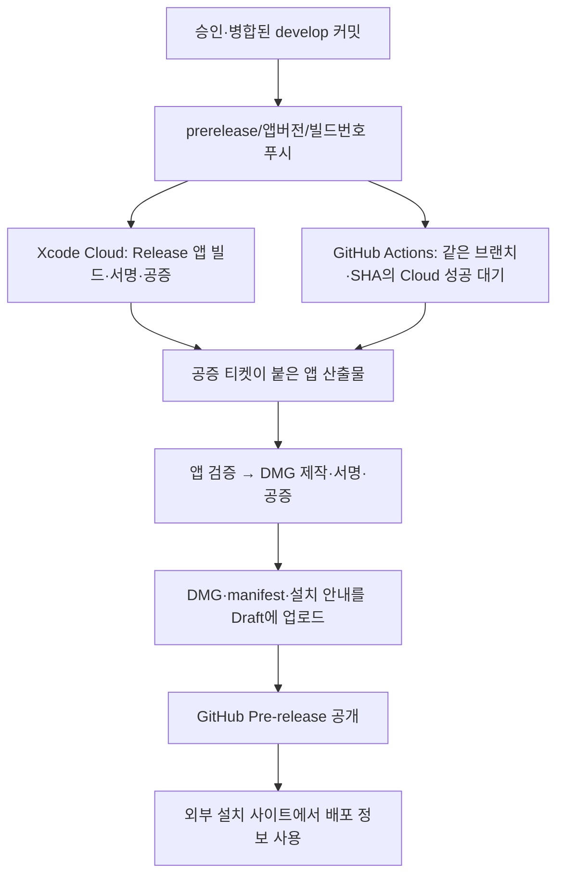

# UMC Desk 공증 DMG와 설치 사이트 배포 설계

작성일: 2026-10-11
갱신일: 2026-10-13
작성자: 제옹(euijjang97)
상태: Cloud 산출물 조회·DMG 패키징·GitHub 게시 자동화 구현 및 빌드 6 게시 확인, 설치 사이트는 별도 확인

UMC Desk 프리배포는 승인·병합된 `origin/develop`의 커밋에서 `prerelease/<앱버전>/<빌드번호>` 브랜치를 푸시해 시작한다. Xcode Cloud에서 앱을 빌드·서명·공증하고, GitHub Actions가 그 공증 산출물을 받아 DMG를 만들어 GitHub Pre-release에 게시한다. 별도의 프리배포 PR은 만들지 않는다.

이 문서는 2026-10-13 저장소 코드를 기준으로 배포 흐름을 설명한다. Cloud 워크플로 설정·비밀값 등록·실제 공증 성공·게시 완료·설치 사이트 운영 상태는 소스 파일의 존재만으로 확인하지 않는다. 현재 앱 버전은 `0.0.1`이며 최신 게시 빌드 번호는 배포 전에 릴리스 목록에서 확인한다.

2026-10-13 GitHub 조회에서는 [0.0.1 빌드 6 Pre-release](https://github.com/UMC-PRODUCT/umc-product-macOS/releases/tag/v0.0.1-build.6)가 Draft가 아닌 최신 프리배포로 확인됐다. 게시 시각은 `2026-10-13T05:42:49Z`이며 `prerelease/0.0.1/6`의 [Cloud DMG 게시 실행](https://github.com/UMC-PRODUCT/umc-product-macOS/actions/runs/38352229992)과 `develop`의 [Tuist CI 실행](https://github.com/UMC-PRODUCT/umc-product-macOS/actions/runs/38352046281)은 성공했다. 이 기록은 해당 시점의 배포·CI 결과이며 설치 사이트나 실제 서버 연동을 검증한 결과는 아니다.

## 1. 현재 구현 범위

| 항목 | 저장소에서 확인한 상태 |
| --- | --- |
| 앱·설치 화면 | UMC Desk 이름·아이콘, 앱·화살표·Applications 바로가기 DMG 레이아웃 구현 |
| 로컬 테스트 DMG | `make dmg-test`로 universal Debug 앱을 ad-hoc 서명해 공증 없이 패키징 |
| 로컬 공증 DMG | `make dmg-release`로 universal Release 앱과 DMG의 서명·공증·티켓 첨부·평가 수행 |
| Cloud 프로젝트 준비 | `UMCDesk/ci_scripts/ci_post_clone.sh`가 도구·의존성 설치 후 워크스페이스 생성 |
| Cloud 산출물 조회 | 브랜치·소스 SHA·워크플로가 일치하는 성공 빌드의 `STAPLED_NOTARIZED_ARCHIVE` 선택 |
| GitHub 게시 자동화 | 공증된 앱 검증, DMG 공증, Draft 업로드 후 Pre-release 공개 구현 |
| 설치 사이트 계약 | DMG와 `release.json`, 릴리스 본문의 manifest 제공. 사이트 코드는 이 저장소에 없음 |
| 앱 기능·API 환경 | Auth는 로컬 UI 상태. 커밋된 `BASE_URL`은 `.invalid` 임시값이며 실제 API 연결은 별도 작업 |

앱 내부에는 업데이트 상태 UI가 있지만 실제 다운로드·검증·설치나 자동 업데이트 엔진은 연결되지 않았다. 팀원은 배포된 DMG를 받아 Applications의 기존 앱을 교체한다.

## 2. 현재 배포 흐름



GitHub Actions는 브랜치 push 또는 수동 `workflow_dispatch`로 실행한다. 이전 설계의 완료 웹훅 수신 서버와 `repository_dispatch`는 현재 구현에 포함되지 않는다. Actions가 App Store Connect API를 직접 조회한다.

구현 진입점은 [게시 워크플로](../../.github/workflows/publish-cloud-dmg.yml), [Cloud 조회 스크립트](../../tools/xcode-cloud/download_notarized.mjs), [Cloud DMG 패키징](../../tools/dmg/package_cloud_dmg.py)이다.

## 3. 버전·빌드·미리보기 규칙

| 항목 | 규칙·예시 |
| --- | --- |
| 앱 버전 | `Settings+Recommended.swift`의 `MARKETING_VERSION`, 현재 `0.0.1` |
| 배포 브랜치 | `prerelease/0.0.1/12` |
| 앱 빌드 번호 | 브랜치 마지막의 양의 정수, 예시 `12` |
| Git 태그 | `v0.0.1-build.12` |
| DMG | `UMC-Desk-0.0.1-build12.dmg` |
| GitHub 분류 | Pre-release |

예시 번호는 최신 배포나 다음 사용 가능 번호를 뜻하지 않는다. 이미 사용한 태그·빌드 번호를 재사용하지 않으며 소스 SHA는 실제 Cloud 앱을 빌드한 커밋과 일치해야 한다.

Cloud 준비 스크립트는 브랜치 버전과 `MARKETING_VERSION`이 다르거나 빌드 번호가 올바른 양의 정수가 아니면 중단한다. 프리배포에서는 브랜치의 번호를 `TUIST_BUILD_NUMBER`로 전달한다. 일반 Cloud 실행은 `CI_BUILD_NUMBER`를 사용하므로 Cloud 실행 순번과 앱 빌드 번호가 다를 수 있다.

Debug와 `UMC_PRERELEASE` 빌드에는 Auth 화면·흐름·Light/Dark·타이포그래피 미리보기가 들어간다. 일반 Release에는 이 도구와 지연 흐름 재생이 빠진다. `TUIST_PRERELEASE=1`은 Tuist 생성 때 컴파일 조건을 설정하므로 Xcode 빌드의 `Release` 선택만으로 프리배포 여부가 결정되지 않는다.

## 4. Cloud와 Actions 설정

Xcode Cloud에는 해당 브랜치의 Release Archive, Developer ID 배포와 앱 공증 후속 작업을 설정해야 한다. 준비 스크립트는 Tuist `4.208.0`을 설치하고 의존성을 받아 프로젝트를 생성한다. Cloud 제품·워크플로 ID는 조회 스크립트의 상수이므로 Cloud 프로젝트를 다시 만들면 함께 확인한다.

Actions에는 다음 저장소 비밀값이 필요하다. 이름은 현재 워크플로와 일치한다.

| 비밀값 | 용도 |
| --- | --- |
| `APPLE_KEY_ID`·`APPLE_ISSUER_ID`·`APPLE_PRIVATE_KEY` | Cloud API 조회와 DMG 공증 인증 |
| `DEVELOPER_ID_P12_BASE64`·`DEVELOPER_ID_P12_PASSWORD` | DMG 서명용 Developer ID Application 인증서·개인 키 |

현재 워크플로의 서명 identity는 `Developer ID Application: euichan Jeong (8B8B4462NV)`이며 앱 검증도 팀 `8B8B4462NV`를 요구한다. 인증서는 임시 Keychain에 가져오고 종료 시 Keychain과 임시 자격증명 파일을 정리한다. GitHub 게시는 `contents: write` 권한의 작업 `GITHUB_TOKEN`을 사용한다.

API 환경은 서명 환경과 별도로 준비한다. 현재 Cloud 스크립트는 `Secrets.xcconfig`를 만들거나 Cloud의 `BASE_URL` 환경변수를 파일에 반영하지 않는다. 실제 서버에 연결하는 빌드를 만들 때는 [환경 설정 안내](../../UMCDesk/Secrets/README.md)에 따라 API 주소가 앱에 들어가는 경로를 확인한다.

## 5. 산출물 선택·패키징·게시

1. 브랜치 형식과 소스 커밋의 `origin/develop` 포함 여부를 검사하고 기존 태그가 있으면 중단한다.
2. 브랜치·소스 SHA·설정된 워크플로가 일치하는 Cloud 실행을 최대 45분 기다린다. 완료 상태와 성공 여부를 확인한다.
3. 성공한 작업에서 `STAPLED_NOTARIZED_ARCHIVE`가 정확히 하나인지 확인한다. 허용된 Apple HTTPS 저장소에서 선언된 크기와 일치하는 파일만 받으며 최대 크기는 1 GiB다.
4. ZIP 경로와 symlink를 검사하고 앱의 bundle ID·버전·빌드 번호, `arm64`·`x86_64`, 각 아키텍처의 Developer ID·팀·Hardened Runtime·timestamp를 확인한다.
5. 이미 공증된 앱의 서명·티켓·Gatekeeper를 검사하고 앱 재공증 없이 DMG를 제작한다. DMG는 서명·공증·티켓 첨부·평가를 거친다.
6. DMG·`release.json`·`설치 안내.txt`를 Draft Pre-release에 업로드한 뒤 공개한다.

공증 산출물이 없거나 여러 개이면 일반 Archive로 대체하지 않고 실패한다. 공개 태그와 배포 파일을 덮어쓰지 않는다. 업로드 중 실패해 Draft가 남으면 상태와 원본을 확인한 뒤 복구한다. 현재 워크플로에는 GitHub에서 업로드 파일을 다시 내려받아 체크섬을 대조하는 단계는 없다.

공증 제출 UUID와 결과는 `notarization-records` Actions artifact로 보관한다. 공증 대기 중 중단됐다면 저장된 UUID부터 조회한다. 게시 작업의 전체 제한 시간은 75분이다.

## 6. 설치 사이트에 제공하는 정보

Cloud 패키징은 `release.json`과 같은 JSON을 포함한 릴리스 본문을 생성한다. manifest에는 버전·최소 macOS·아키텍처·DMG URL·크기·SHA-256·릴리스 URL·소스 SHA·Cloud 실행 ID가 들어간다. 별도 `build` 필드는 없으며 빌드 번호는 태그와 파일명에 담긴다.

설치 사이트는 공개 GitHub 릴리스 목록에서 Pre-release를 포함해 조회하고 업로드된 DMG·manifest와 태그의 일치를 검증하는 방식으로 연결할 수 있다. `/releases/latest`만으로는 프리배포 채널을 조회할 수 없다. 빌드 번호는 정수로 비교하고 Draft나 필요한 asset이 없는 릴리스는 선택하지 않는 기준이 필요하다.

사이트 구현은 이 저장소의 범위 밖이다. 고정 다운로드 API, 페이지네이션, 장애 시 이전 다운로드 유지, 캐시 주기, 실제 버튼 연결은 사이트 소스와 운영 환경에서 확인한다. 이전 문서의 `/api/downloads/macos?channel=beta`와 5분 캐시는 제안이었으며 이 저장소에 구현된 API·설정으로 취급하지 않는다.

## 7. 검증과 운영 확인

저장소의 자동화 검증 명령은 다음과 같다.

```sh
node --test tools/tests/*.test.mjs
python3 -m unittest discover -s tools/tests -v
make test-dmg
```

Python 테스트는 DMG 의존성이 없으면 실제 이미지 생성 검사를 건너뛸 수 있다. `make test-dmg`는 로컬 패키징 도구를 준비해 macOS 이미지와 복사 검사를 실행한다. 이 테스트는 실제 Apple 공증 제출이나 GitHub 릴리스 게시 성공을 대신하지 않는다.

배포 전에는 Cloud 워크플로·비밀값·서명 환경을 확인하고 미사용 빌드 번호로 Cloud 앱과 DMG의 공증·게시 결과를 확인한다. 이후 팀원 Mac에서 설치·기존 앱 교체·필요한 API 환경을 검사한다. 설치 사이트 운영 담당과 연결할 작업이 있으면 [Handbook Ownership Registry](https://github.com/UMC-PRODUCT/umc-product-handbook/blob/main/ownership-registry.md)의 최신 책임 범위를 확인해 요청한다. 담당자 이름만으로 새 작업의 수락·일정 합의를 단정하지 않는다.

로컬 테스트·공증 명령과 복구 방법은 [Makefile 안내](../../UMCDesk/MAKEFILE_GUIDE.md), 비밀값·Cloud 조회·게시 세부 동작은 [Cloud 운영 안내](../../tools/xcode-cloud/README.md)를 따른다.
